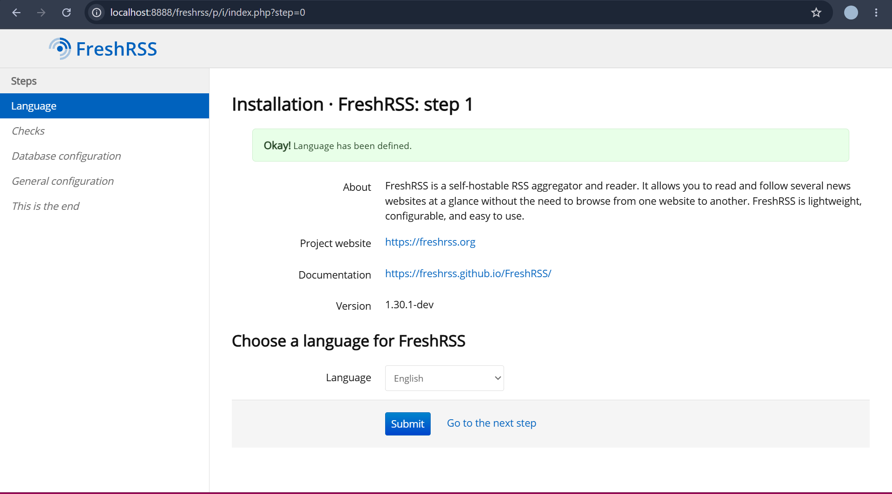
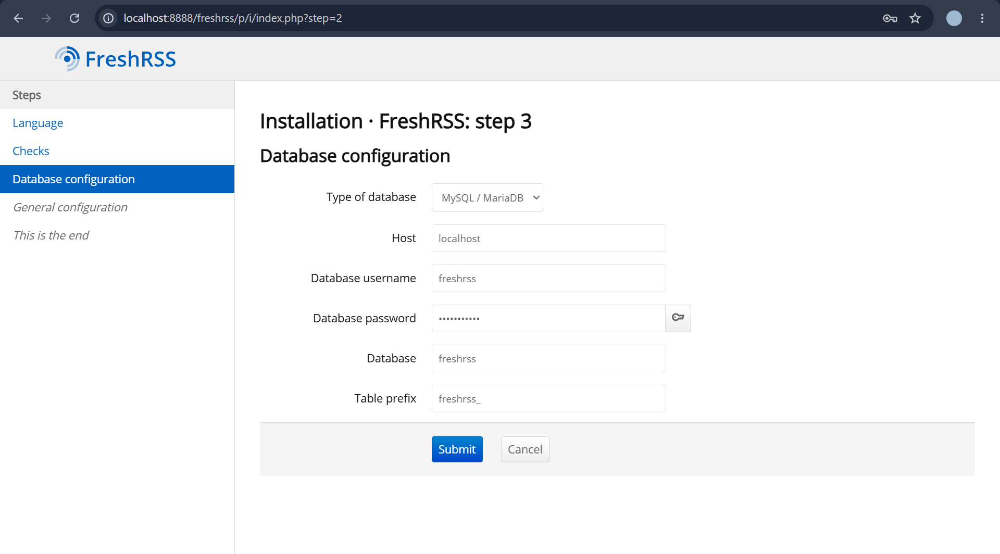
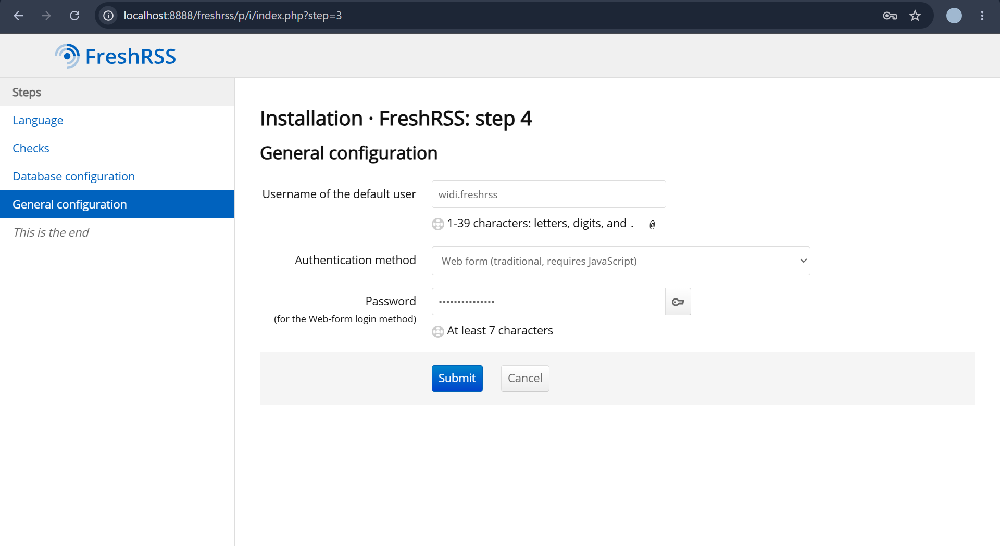
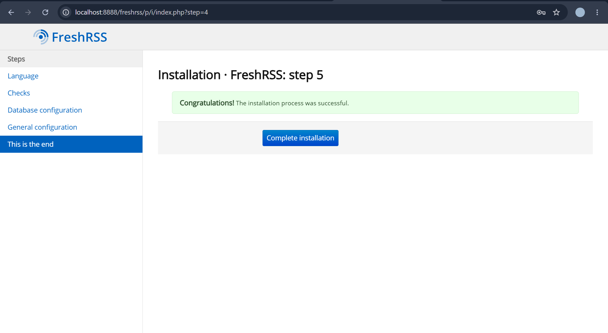
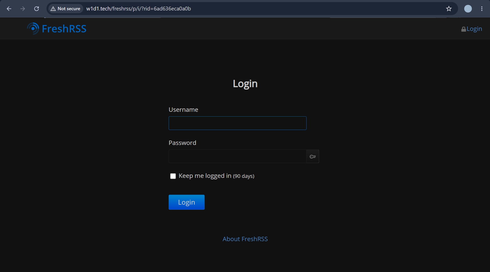
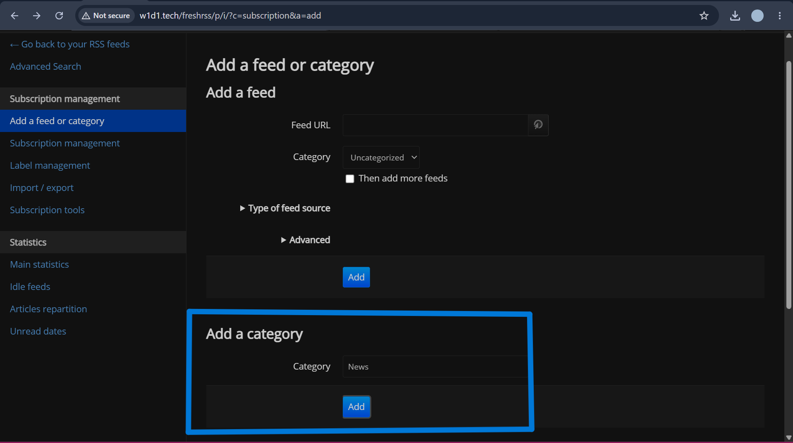
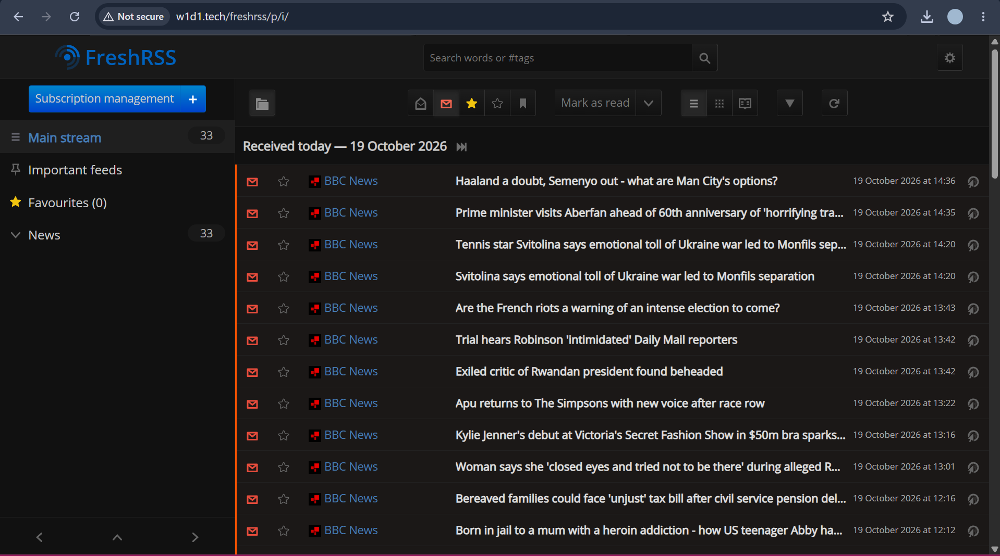

<h1 align="center">
  
</h1>

<h1 align="center">FreshRSS</h1>

<p align="center">
  Aplikasi pembaca umpan RSS berbasis web untuk mengumpulkan dan membaca artikel dari berbagai sumber dalam satu tempat.
</p>

# FreshRSS

## Sekilas Tentang

FreshRSS adalah aplikasi web *feed aggregator* atau pembaca umpan RSS yang bersifat gratis dan sumber terbuka (*open source*). Aplikasi ini memungkinkan pengguna berlangganan berbagai sumber informasi, seperti portal berita, blog, dan situs teknologi, kemudian membaca artikel terbaru dari satu antarmuka.

FreshRSS dapat dipasang pada server sendiri sehingga pengguna memiliki kendali atas aplikasi dan data langganannya. Aplikasi ini menyediakan fitur pengelolaan umpan RSS, kategori, penandaan artikel, serta pengaturan tampilan membaca.

Pada proyek ini, FreshRSS diinstal secara langsung pada VPS Hostinger menggunakan sistem operasi Ubuntu Server, Apache sebagai web server, PHP sebagai lingkungan pemrosesan aplikasi, dan MySQL sebagai database. Aplikasi diakses melalui domain yang telah dikonfigurasi.

## Instalasi

### 1. Prasyarat

Sebelum melakukan instalasi FreshRSS, siapkan beberapa kebutuhan berikut.

- VPS Hostinger dengan sistem operasi Ubuntu Server.
- Akses SSH untuk mengelola server.
- Domain yang diarahkan ke alamat IP VPS.
- Apache sebagai web server.
- PHP beserta ekstensi yang dibutuhkan FreshRSS.
- MySQL sebagai database.
- Git untuk mengunduh kode sumber FreshRSS.
- Certbot untuk mengaktifkan HTTPS menggunakan Let's Encrypt (opsional, tetapi disarankan).

### 2. Memperbarui Sistem

Hubungkan ke VPS melalui SSH menggunakan terminal. Pada komputer Windows, koneksi dapat dilakukan melalui PowerShell atau Windows Terminal.

```bash
ssh root@IP_VPS
```

Ganti `IP_VPS` dengan alamat IP VPS yang digunakan. Setelah berhasil masuk, perbarui daftar paket dan sistem.

```bash
sudo apt update
sudo apt upgrade -y
```

### 3. Menginstal Apache, PHP, MySQL, dan Git

Instal paket yang diperlukan untuk menjalankan FreshRSS.

```bash
sudo apt install -y apache2 mysql-server git \
php php-cli php-mysql php-curl php-gd \
php-mbstring php-xml php-zip php-intl
```

Aktifkan Apache dan MySQL agar berjalan secara otomatis ketika server dinyalakan.

```bash
sudo systemctl enable --now apache2
sudo systemctl enable --now mysql
```

Periksa status kedua layanan.

```bash
sudo systemctl status apache2
sudo systemctl status mysql
```

### 4. Mengunduh FreshRSS

Masuk ke direktori web Apache dan unduh kode sumber FreshRSS dari repositori resminya.

```bash
cd /var/www/html
sudo git clone https://github.com/FreshRSS/FreshRSS.git freshrss
```

Atur kepemilikan direktori agar Apache dapat mengakses berkas aplikasi.

```bash
sudo chown -R www-data:www-data /var/www/html/freshrss
```

> Jika FreshRSS sudah terpasang pada VPS, lewati langkah ini agar direktori aplikasi yang sudah ada tidak tertimpa.

### 5. Membuat Database MySQL

Masuk ke MySQL sebagai administrator.

```bash
sudo mysql
```

Buat database dan pengguna khusus untuk FreshRSS. Ganti `PASSWORD_KUAT` dengan kata sandi yang aman.

```sql
CREATE DATABASE freshrss
CHARACTER SET utf8mb4
COLLATE utf8mb4_unicode_ci;

CREATE USER 'freshrss_user'@'localhost'
IDENTIFIED BY 'PASSWORD_KUAT';

GRANT ALL PRIVILEGES ON freshrss.*
TO 'freshrss_user'@'localhost';

FLUSH PRIVILEGES;
EXIT;
```

Database `freshrss` digunakan untuk menyimpan data aplikasi yang didukung oleh konfigurasi database FreshRSS. Kredensial database selanjutnya dimasukkan pada proses instalasi melalui browser.

> Jika database dan pengguna FreshRSS sudah dibuat sebelumnya, gunakan konfigurasi yang tersedia dan jangan membuat ulang akun dengan nama yang sama.

### 6. Mengatur Hak Akses dan Konfigurasi Web Server

Pastikan direktori aplikasi dapat dibaca oleh Apache.

```bash
sudo chown -R www-data:www-data /var/www/html/freshrss
```

Aktifkan modul Apache yang diperlukan.

```bash
sudo a2enmod rewrite headers expires
sudo systemctl reload apache2
```

Pastikan domain sudah diarahkan ke IP VPS melalui DNS. Jika menggunakan domain `w1d1.tech`, periksa bahwa record DNS mengarah ke alamat IP VPS yang benar.

Jika konfigurasi virtual host belum tersedia, buat berkas konfigurasi Apache.

```bash
sudo nano /etc/apache2/sites-available/freshrss.conf
```

Masukkan konfigurasi berikut.

```apache
<VirtualHost *:80>
    ServerName w1d1.tech
    ServerAlias www.w1d1.tech

    DocumentRoot /var/www/html

    <Directory /var/www/html/freshrss>
        Options FollowSymLinks
        AllowOverride All
        Require all granted
    </Directory>

    ErrorLog ${APACHE_LOG_DIR}/freshrss-error.log
    CustomLog ${APACHE_LOG_DIR}/freshrss-access.log combined
</VirtualHost>
```

Aktifkan konfigurasi dan periksa sintaks Apache.

```bash
sudo a2ensite freshrss.conf
sudo apache2ctl configtest
sudo systemctl reload apache2
```

Jika domain sudah digunakan oleh konfigurasi virtual host yang ada, sesuaikan konfigurasi tersebut daripada membuat konfigurasi duplikat.

### 7. Mengatur HTTPS

HTTPS digunakan untuk mengenkripsi komunikasi antara browser dan server. Pastikan domain telah mengarah ke VPS dan port 80 dapat diakses dari internet sebelum menjalankan Certbot.

Instal Certbot dan plugin Apache.

```bash
sudo apt install -y certbot python3-certbot-apache
```

Jalankan perintah berikut untuk memperoleh sertifikat SSL.

```bash
sudo certbot --apache -d w1d1.tech -d www.w1d1.tech
```

Ikuti petunjuk yang ditampilkan sampai proses selesai. Pastikan port 443 diizinkan pada firewall VPS dan firewall Hostinger.

### 8. Menyelesaikan Instalasi melalui Browser

Setelah Apache, PHP, MySQL, dan domain dikonfigurasi, buka alamat instalasi FreshRSS melalui browser.

- Pilih bahasa yang akan digunakan.

  

- Periksa ketersediaan PHP dan ekstensi yang diperlukan.

  

- Pilih MySQL sebagai database dan masukkan host, nama database, username, serta password sesuai konfigurasi yang telah dibuat.

  

- Buat akun administrator dengan menentukan username dan password.

  

- Selesaikan proses instalasi sesuai petunjuk yang ditampilkan.

  

Setelah proses selesai, FreshRSS dapat diakses melalui browser menggunakan alamat domain yang telah dikonfigurasi.

## Konfigurasi

### 1. Konfigurasi Database

FreshRSS menggunakan MySQL sebagai database pada proyek ini. Penggunaan database terpisah memungkinkan data aplikasi dikelola melalui layanan database server.

Informasi konfigurasi database yang digunakan:

- **Nama database:** `freshrss`
- **Username database:** `freshrss_user`
- **Host database:** `localhost`
- **Jenis database:** MySQL

Password database disimpan sebagai informasi konfigurasi dan tidak dicantumkan dalam dokumentasi publik.

### 2. Konfigurasi PHP

PHP digunakan untuk menjalankan kode aplikasi FreshRSS. Ekstensi PHP seperti `php-curl`, `php-xml`, `php-mbstring`, `php-gd`, dan `php-zip` membantu mendukung kebutuhan aplikasi.

Konfigurasi PHP dapat diperiksa melalui terminal.

```bash
php -v
php -m
```

Apabila aplikasi mengalami kendala terkait ekstensi atau batas memori, periksa berkas `php.ini` yang digunakan oleh PHP dan Apache. Lokasi berkas dapat berbeda bergantung pada versi PHP yang terpasang.

Setelah mengubah konfigurasi PHP untuk Apache, muat ulang layanan.

```bash
sudo systemctl restart apache2
```

### 3. Konfigurasi Domain dan HTTPS

Domain `w1d1.tech` digunakan sebagai alamat akses aplikasi. HTTPS diaktifkan menggunakan sertifikat SSL agar koneksi antara pengguna dan server lebih aman.

Pastikan DNS domain, konfigurasi Apache, serta aturan firewall VPS sesuai dengan kebutuhan akses web.

## Maintenance

Maintenance dilakukan untuk menjaga aplikasi tetap berjalan dengan baik, mengurangi risiko kehilangan data, dan memastikan server memperoleh pembaruan keamanan.

### 1. Memperbarui Sistem

Periksa dan instal pembaruan paket sistem secara berkala.

```bash
sudo apt update
sudo apt upgrade -y
```

Sebelum memperbarui aplikasi atau paket utama, pastikan data penting sudah dicadangkan.

### 2. Memeriksa Status Layanan

Periksa status Apache dan MySQL untuk memastikan layanan berjalan.

```bash
sudo systemctl status apache2
sudo systemctl status mysql
```

Jika aplikasi tidak dapat diakses, periksa log Apache.

```bash
sudo tail -n 50 /var/log/apache2/error.log
```

### 3. Backup Database

Backup database secara berkala penting untuk mengantisipasi kerusakan data atau kesalahan konfigurasi.

Jalankan perintah berikut untuk membuat cadangan database MySQL.

```bash
sudo mysqldump freshrss > "$HOME/freshrss-backup.sql"
```

Perintah tersebut membuat berkas cadangan SQL pada direktori home pengguna yang menjalankan perintah. Pastikan lokasi penyimpanan memiliki ruang yang cukup dan file backup dipindahkan ke lokasi aman di luar VPS.

Untuk pemulihan database, gunakan akun MySQL yang memiliki hak akses sesuai kebutuhan.

```bash
mysql -u freshrss_user -p freshrss < freshrss-backup.sql
```

Lakukan pemulihan hanya setelah memastikan berkas backup benar dan database tujuan sudah dipersiapkan.

### 4. Memeriksa Sertifikat SSL

Periksa masa berlaku sertifikat SSL dan status mekanisme pembaruannya.

```bash
sudo certbot certificates
sudo certbot renew --dry-run
```

Perintah kedua menguji proses pembaruan sertifikat tanpa melakukan pembaruan sertifikat yang sebenarnya.

## Otomatisasi

Beberapa tugas maintenance dapat diotomatisasi menggunakan skrip shell dan penjadwal `cron`. Contoh berikut digunakan untuk membuat backup database harian.

### 1. Membuat Skrip Backup

Buat direktori khusus untuk skrip maintenance.

```bash
mkdir -p "$HOME/scripts"
nano "$HOME/scripts/backup-freshrss.sh"
```

Masukkan kode berikut.

```bash
#!/bin/bash

set -e

BACKUP_DIR="$HOME/backups/freshrss"
DATE=$(date +"%Y-%m-%d_%H-%M-%S")

mkdir -p "$BACKUP_DIR"

mysqldump freshrss \
  > "$BACKUP_DIR/freshrss-$DATE.sql"

find "$BACKUP_DIR" \
  -type f -name "freshrss-*.sql" -mtime +7 -delete
```

Skrip tersebut membuat backup database dengan nama yang menyertakan tanggal dan waktu. Berkas backup yang berusia lebih dari tujuh hari akan dihapus secara otomatis.

Aktifkan izin eksekusi.

```bash
chmod +x "$HOME/scripts/backup-freshrss.sh"
```

Uji skrip secara manual terlebih dahulu.

```bash
"$HOME/scripts/backup-freshrss.sh"
```

Pastikan akun yang menjalankan skrip memiliki akses MySQL tanpa interaksi password. Untuk penggunaan rutin, atur autentikasi MySQL yang aman melalui berkas konfigurasi khusus dengan izin terbatas; jangan menaruh password database secara langsung di skrip.

### 2. Menjadwalkan Backup Otomatis

Buka konfigurasi cron milik pengguna yang akan menjalankan skrip.

```bash
crontab -e
```

Tambahkan baris berikut untuk menjalankan backup setiap hari pukul 02.00 waktu server.

```cron
0 2 * * * /bin/bash "$HOME/scripts/backup-freshrss.sh" >> "$HOME/freshrss-backup.log" 2>&1
```

Jadwal tersebut menjalankan backup database secara otomatis setiap hari. Periksa log dan hasil backup secara berkala. Backup yang hanya tersimpan di VPS yang sama tidak melindungi data jika seluruh VPS mengalami kerusakan, sehingga salinan eksternal tetap disarankan.

## Cara Pemakaian

### 1. Mengakses FreshRSS

FreshRSS dapat diakses melalui browser menggunakan alamat domain yang telah dikonfigurasi.

**Alamat aplikasi:** [https://w1d1.tech/freshrss](https://w1d1.tech/freshrss)

**Tampilan halaman login FreshRSS:**



**Tampilan halaman utama FreshRSS:**


### 2. Menambahkan Kategori

Kategori digunakan untuk mengelompokkan umpan RSS berdasarkan topik tertentu, seperti teknologi, pendidikan, dan berita internasional. Dengan adanya kategori, pengguna dapat mengatur langganan agar lebih mudah ditemukan.



### 3. Menambahkan Umpan RSS

Pengguna dapat menambahkan sumber berita melalui menu pengelolaan langganan (*Subscriptions management*) dengan memasukkan alamat RSS dari situs yang diinginkan.

Pada pengujian aplikasi, BBC News digunakan sebagai contoh sumber berita dengan informasi berikut.

- **Nama sumber:** BBC News
- **URL RSS:** `https://feeds.bbci.co.uk/news/rss.xml`
- **Situs web:** `https://www.bbc.co.uk/news`

**Tampilan konfigurasi umpan RSS:**


### 4. Membaca Artikel

Setelah umpan RSS ditambahkan, FreshRSS mengambil artikel yang tersedia dan menampilkannya pada halaman utama. Pengguna dapat memilih artikel untuk membaca informasi yang tersedia atau membuka situs sumbernya.

**Tampilan daftar artikel:**



### 5. Mengelola Langganan

Pengguna dapat mengelola langganan RSS yang sudah ditambahkan, termasuk mengubah pengaturan atau menghapus umpan yang tidak lagi dibutuhkan. Pengelolaan ini membantu menjaga daftar bacaan tetap relevan.

### 6. Mengelola Akun Pengguna

FreshRSS menyediakan pengaturan pengguna yang memungkinkan administrator mengelola akun sesuai kebutuhan. Pengguna dapat mengatur kredensial dan preferensi membaca melalui menu yang tersedia pada aplikasi.

## Pembahasan

### 1. Kelebihan FreshRSS

- **Open source dan gratis:** FreshRSS dapat digunakan tanpa biaya lisensi aplikasi.
- **Kendali data:** Aplikasi dipasang pada server sendiri sehingga administrator memiliki kendali lebih besar atas penyimpanan dan pengelolaan data.
- **Terpusat:** Berbagai sumber berita dan blog dapat dibaca melalui satu antarmuka.
- **Mendukung kategorisasi:** Langganan RSS dapat dikelompokkan agar lebih mudah dikelola.
- **Dapat dikembangkan:** Pengguna dapat menyesuaikan konfigurasi dan memanfaatkan fitur tambahan yang tersedia.

### 2. Kekurangan FreshRSS

- **Membutuhkan pengelolaan server:** Pengguna perlu memahami dasar administrasi VPS, web server, PHP, dan database.
- **Maintenance menjadi tanggung jawab administrator:** Pembaruan, backup, keamanan, serta pemantauan layanan harus dilakukan secara berkala.
- **Bergantung pada sumber RSS:** Artikel yang tersedia bergantung pada umpan yang disediakan masing-masing situs.
- **Membutuhkan konfigurasi awal:** Pengguna perlu menyiapkan server dan melakukan proses instalasi sebelum aplikasi dapat digunakan.

### 3. Perbandingan dengan Aplikasi Sejenis

FreshRSS dapat dibandingkan dengan Miniflux dan Tiny Tiny RSS, yang sama-sama digunakan untuk membaca dan mengelola umpan RSS.

| Aspek | FreshRSS | Miniflux | Tiny Tiny RSS |
|---|---|---|---|
| Tujuan utama | Membaca dan mengelola umpan RSS | Membaca umpan RSS dengan pendekatan minimalis | Membaca dan mengelola umpan RSS |
| Sifat aplikasi | Open source | Open source | Open source |
| Instalasi mandiri | Ya | Ya | Ya |
| Pengelolaan data | Dapat menggunakan database yang didukung aplikasi | Menggunakan PostgreSQL | Menggunakan database yang didukung aplikasi |
| Pengelolaan langganan | Mendukung kategori dan pengaturan langganan | Berfokus pada antarmuka yang sederhana | Mendukung pengelolaan umpan dan fitur tambahan |

Secara umum, ketiga aplikasi dapat menjadi alternatif untuk mengelola informasi dari berbagai sumber RSS. FreshRSS menjadi pilihan yang sesuai untuk proyek ini karena menyediakan antarmuka web untuk membaca artikel, mendukung pengelolaan langganan, dan dapat dipasang pada VPS milik sendiri.

## Referensi

1. FreshRSS. *Official FreshRSS Repository*. GitHub. https://github.com/FreshRSS/FreshRSS
2. FreshRSS. *Official Documentation*. https://freshrss.github.io/FreshRSS/
3. Apache Software Foundation. *Apache HTTP Server Documentation*. https://httpd.apache.org/docs/
4. PHP. *PHP Manual*. https://www.php.net/manual/en/
5. MySQL. *MySQL Reference Manual*. https://dev.mysql.com/doc/
6. Let's Encrypt. *Getting Started*. https://letsencrypt.org/getting-started/
7. Miniflux. *Official Repository*. GitHub. https://github.com/miniflux/v2
8. Tiny Tiny RSS. *Official Repository*. GitHub. https://github.com/tt-rss/tt-rss
